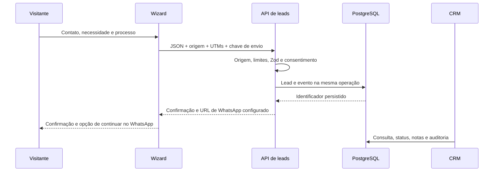

# Arquitetura e segurança

## Fluxo de captação

## Persistência

O schema Drizzle define tabelas, enums, chaves estrangeiras, índices e relações. O código de aplicação usa SQL parametrizado com o driver Neon HTTP; a mesma interface roda em PGlite local. Não há interpolação de valores do usuário nas consultas. Identificadores dinâmicos passam por listas fechadas e validação.

Entidades: users, sessions, site_settings, services, projects, categories, technologies, project_images, project_technologies, leads, lead_notes, lead_events, social_links, content_sections, audit_logs e rate_limits. A tabela auxiliar vieira_migrations registra checksum e execução das migrações.

O envio do lead e seu evento inicial são atômicos, com chave UUID única e fingerprint do conteúdo. Repetições idênticas devolvem o mesmo identificador; conteúdo diferente com a mesma chave é rejeitado. Campos internos de segurança não são retornados pela API pública nem pelo CRM.

## Autenticação e autorização

- Senhas com bcrypt, custo 12. Limite de 72 bytes evita truncamento silencioso.
- Sessão opaca de 256 bits; somente seu hash SHA-256 é armazenado.
- Cookie `HttpOnly`, `SameSite=Strict`; em produção, `Secure` e prefixo `__Host-`.
- Expiração de oito horas, logout revogável, desativação e troca de senha invalidam sessões.
- Admin gerencia todos os recursos. Editor gerencia conteúdo, serviços, projetos e atendimento; não acessa usuários, configurações, sistema ou exclusão de leads.
- Remoção/rebaixamento do último administrador ativo é bloqueado. O usuário não pode remover o próprio acesso.
- A autorização é verificada no servidor por endpoint; esconder o menu não é a barreira de acesso.

## Proteções de entrada

Origem exata em todas as mutações, rejeição de `Sec-Fetch-Site: cross-site`, JSON obrigatório, leitura limitada de corpo, schemas Zod estritos, URLs com protocolos permitidos, texto escapado pelo React e JSON-LD serializado com proteção para `<`.

Limites persistentes por identidade e escopo: login 30/IP e 8/conta em 15 minutos; leads 15/IP e 5/e-mail por hora. IP/e-mail entram no contador como HMAC. Contadores vencidos são removidos. Em execução local sem proxy confiável, o endereço é compartilhado; a Vercel fornece cabeçalho sobrescrito pela plataforma.

Cookies não substituem a checagem de origem. Falhas retornam mensagens controladas, sem stack, consulta SQL ou parâmetros sensíveis nos logs.

## CMS e publicação

As seções têm formatos conhecidos, com merge defensivo sobre defaults para evitar que um registro malformado quebre o site. O painel oferece campos e listas estruturadas, sem HTML executável. Projetos não publicados e serviços inativos não aparecem nas páginas públicas. Cliente oculto é removido no acesso público aos dados.

## Privacidade e operação

O formulário grava data e versão do consentimento. Campos do orçamento não são enviados como eventos de analytics. A atribuição armazena apenas o caminho inicial e UTMs da aba. Preferências de tema e cookies ficam no navegador; a sessão administrativa usa cookie protegido.

Google Analytics, GTM e Meta Pixel ficam ausentes até IDs válidos e consentimento. A revogação remove os cookies conhecidos acessíveis e recarrega o documento, interrompendo runtimes já carregados. Tags adicionais dentro do GTM são responsabilidade da configuração desse container.

O service worker mantém apenas a página offline e o ícone. Não armazena respostas de API, administração ou dados de formulários.

A abstração de object storage valida tipo/tamanho e mantém binários fora do banco. O upload não é exposto sem adaptador. URLs de galeria são renderizadas sem proxy de imagens arbitrárias no servidor.

## Evolução

Para aumentar escala, considerar paginação de coleções administrativas extensas, cache público com invalidação explícita e limites externos especializados. O desenho atual mantém o conteúdo imediatamente consistente e os limites compartilhados entre instâncias serverless.
